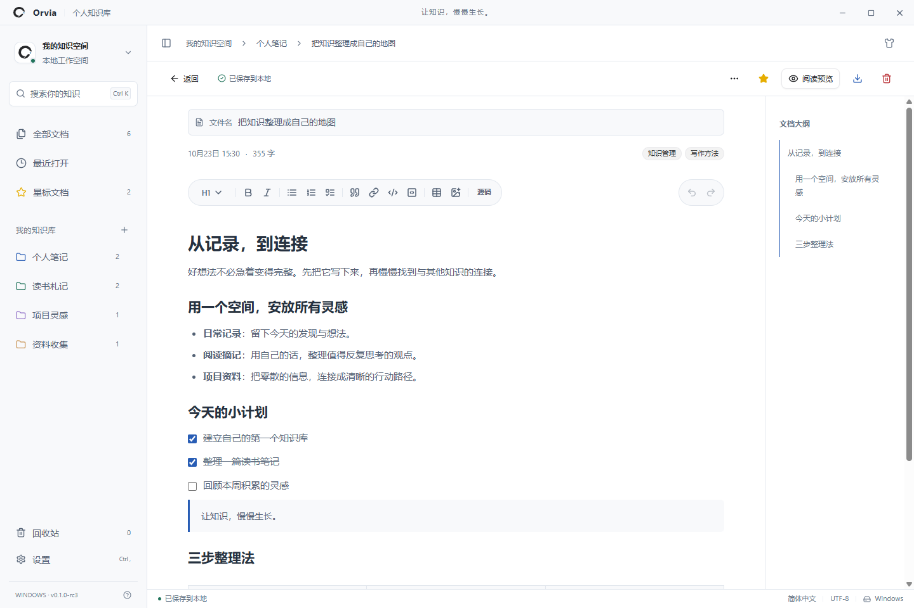
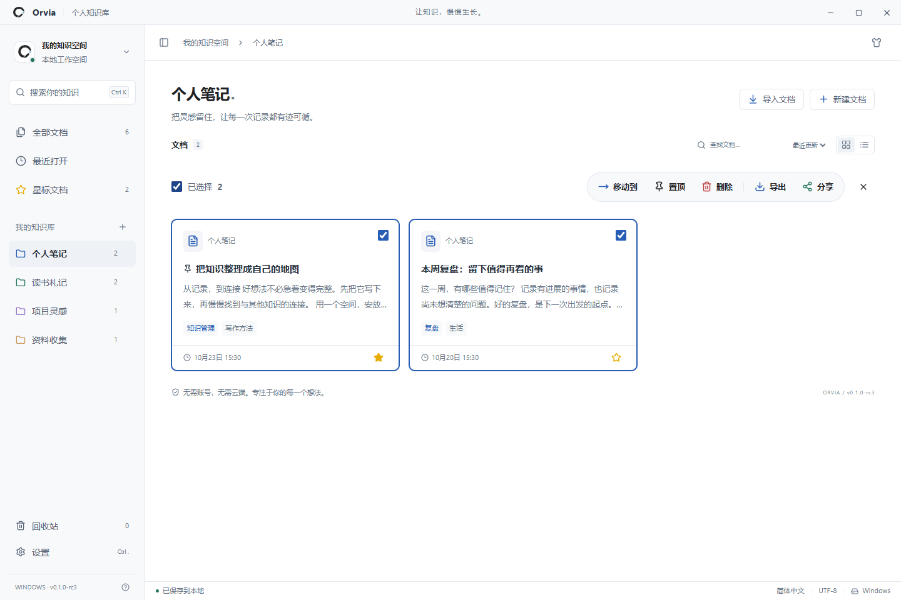
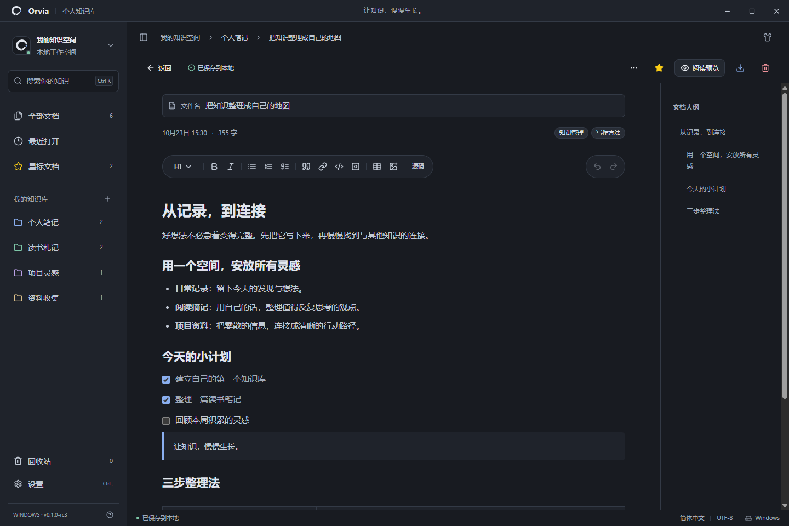
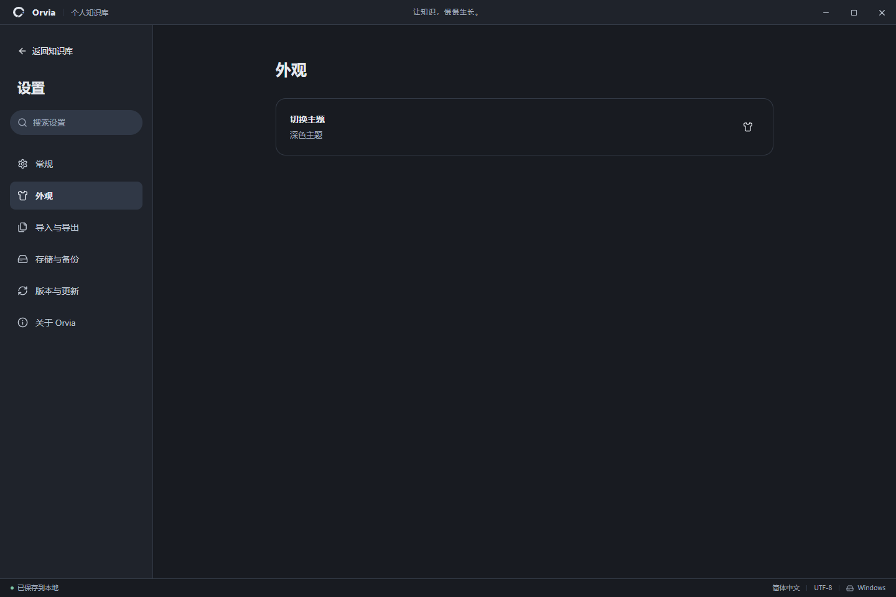

<p align="center">
  <picture>
    <source media="(prefers-color-scheme: dark)" srcset="public/brand/orvia-symbol-dark.svg" />
    
  </picture>
</p>
<h1 align="center">Orvia for Windows</h1>
<p align="center"><strong>v0.1.0 正式版</strong><br />让知识，慢慢生长。</p>
<p align="center">本地个人知识库 · Markdown 写作 · Windows 桌面应用</p>
<p align="center">
  <a href="https://github.com/zeze49024/orvia-windows/releases">下载应用</a> ·
  <a href="#实机截图">实机截图</a> ·
  <a href="#技术栈">技术栈</a> ·
  <a href="#开发者">开发者</a> ·
  <a href="https://github.com/zeze49024/orvia-windows/issues">反馈问题</a>
</p>

## 关于 Orvia

Orvia 是一款以本地存储为核心的 Markdown 个人知识库，适合日常记录、阅读摘记、资料整理和项目灵感管理。用知识库组织内容，用标签、收藏和置顶保留重点，再通过搜索与回顾，把零散的记录连接起来。

界面采用简约的黑白灰配色，以少量彩色图标表达功能和状态，支持浅色、深色主题。你可以直接编辑排版后的内容，也可以切换到 Markdown 源码或阅读预览，专注于自己的写作方式。

核心笔记功能可离线使用，无需注册账号。笔记、图片和历史记录保存在设备本地，当前不提供云同步，也不上传知识库内容。默认联网仅用于检查、下载应用更新；自动检测可在设置中关闭。v0.1.1-rc1 的可选 AI 默认关闭，提供侧边聊天、选中文字快捷操作和本地会话。设置 Key 时确认一次发送授权，后续主动发送指定笔记文字、指令及当前会话上下文至所选服务商；可在设置撤销，不经过 Orvia 服务器。会话随当前空间保存，加密空间随之加密。

v0.1.1 预览版另提供独立加密知识库、自动备份、存储管理、高级搜索、笔记模板和可配置快捷键。普通知识库不会自动加密；加密、备份与恢复的范围请阅读[本地数据与备份安全](docs/SECURITY-AND-BACKUPS.md)。稳定版与预览版请在 [Releases](https://github.com/zeze49024/orvia-windows/releases) 按需选择。

## 功能概览

| 功能 | 说明 |
| --- | --- |
| Markdown 写作 | 实时编辑、源码编辑、阅读预览；支持 H1–H6 标题、加粗、斜体、列表、任务、引用、代码、表格和图片，提供撤销与重做。 |
| 文档大纲 | 根据标题生成大纲，便于浏览长文并跳转到对应段落。 |
| 知识库管理 | 多知识库分类、标签、收藏、独立置顶、最近打开、搜索、排序，以及卡片和列表视图。 |
| 单篇与批量操作 | 右键快捷移动单篇笔记；多选后可移动、置顶、删除、导出和分享。删除、移动操作需要二次确认。 |
| 本地导入 | 支持 Markdown、TXT、DOCX、文字型 PDF 和常见图片；选择 Markdown 文件夹时可同时解析目录内的相对路径图片。 |
| Markdown 导出 | 单篇导出为独立 `.md`；批量导出可选择独立 `.md` 文件或 ZIP，本地图片嵌入文档。 |
| 离线分享 | 将所选笔记与本地图片生成独立 HTML 文件，接收方可用浏览器阅读，无需在线托管。 |
| 保存与恢复 | SQLite 本地增量保存、自动保存、回收站、历史版本恢复，以及完整备份的导出、校验与合并恢复。 |
| 主题与语言 | 内置浅色、深色主题，提供简体中文、繁体中文和英文，并预留主题与语言资源扩展方式。 |
| 应用更新 | 默认在启动后 10 秒及运行期间每 6 小时检查更新；发现新版本后显示带下载图标的蓝色徽章，点击后保存、下载、校验并安装。 |

## v0.1.1-rc1 候选版

[下载最新候选版](https://github.com/zeze49024/orvia-windows/releases/tag/v0.1.1-rc1) · [更新日志](docs/RELEASE-v0.1.1-rc1.md)

- 全部九个设置页面统一分组、间距与表单样式，信息更集中、操作更清晰。
- 优化 AI、备份存储、模板快捷键与安全页面；兼容明暗主题、三种语言与窄窗口。

## v0.1.1-beta7 预览版

[下载最新预览版](https://github.com/zeze49024/orvia-windows/releases/tag/v0.1.1-beta7) · [更新日志](docs/RELEASE-v0.1.1-beta7.md)

- 打磨 AI 侧边聊天，阅读旧回复时保持位置，可一键回到最新回复。
- 对话搜索、会话切换草稿保留、等待时起草、代码复制，以及更清楚的上下文与停止/失败状态。
- 支持用户自带 DeepSeek / OpenAI Key，配置时一次授权，笔记修改前仍需审阅确认。

## v0.1.1-beta2 预览版

[下载预览版](https://github.com/zeze49024/orvia-windows/releases/tag/v0.1.1-beta2) · [更新日志](docs/RELEASE-v0.1.1-beta2.md)

- 更清楚的保存状态、保存失败重试，以及独立草稿检查点与恢复副本。
- 编辑页面新增 PDF 导出，保留标题、列表、表格与本地图片，适合打印和分享。

## v0.1.1-beta1 预览版

[下载预览版](https://github.com/zeze49024/orvia-windows/releases/tag/v0.1.1-beta1) · [完整更新日志](docs/RELEASE-v0.1.1-beta1.md)

- 文档内查找与替换：Ctrl+F / Ctrl+H、匹配高亮、大小写匹配、逐项与全部替换，支持撤销。
- 图片操作：粘贴截图、拖入本地图片、预览、替代文字与显示宽度设置，保留 Markdown 导出兼容性。
- 写作现场恢复：重新打开笔记时恢复编辑模式、光标与滚动位置。


以下“实机截图”章节展示 v0.1.0 正式版，预览版新增功能见上图与更新日志。

## 实机截图

以下截图来自 **Windows 原生客户端实际运行**，使用独立演示数据，不包含个人知识库内容。界面中的构建号以实际运行版本为准。

### 工作空间与知识库

通过知识库、标签和卡片整理内容，在同一个空间中搜索和回顾自己的记录。


### Markdown 实时编辑

左侧胶囊集中放置格式工具，右侧胶囊提供撤销与重做；文档大纲位于编辑区右侧。



### 单篇与批量管理

右键可直接移动当前笔记或进入多选，批量工具胶囊提供移动、置顶、删除、导出和分享。



### 深色主题

深色主题覆盖导航、正文、大纲和工具栏，保留功能图标的颜色区分。



### 独立设置页

设置提供分类导航与搜索，包含常规、外观、导入与导出、存储与备份、版本与更新、关于等分类。



## 技术栈

| 层级 | 技术与用途 |
| --- | --- |
| 前端应用 | **React 19、TypeScript 5、Vite 6**：界面开发、类型约束和构建。 |
| 界面与样式 | **shadcn/ui、Radix UI、Tailwind CSS 4、Lucide**：组件、交互、主题与图标。 |
| Markdown 编辑 | **Tiptap 3 / ProseMirror**：实时编辑；**react-markdown、remark-gfm、unified**：Markdown 解析与阅读渲染。 |
| Windows 桌面 | **Tauri 2、Rust、Microsoft Edge WebView2**：原生窗口、本地能力与前端界面的连接。 |
| 本地存储 | **SQLite、rusqlite**：知识库、笔记和历史记录，通过 Rust IPC 执行增量事务。浏览器开发预览使用独立 IndexedDB。 |
| 数据与图片校验 | **Zod、SHA-256**：数据结构校验、图片内容寻址与完整性验证。 |
| 文件处理 | **Mammoth、PDF.js、fflate**：DOCX 转换、PDF 文字提取，以及备份与 ZIP 文件处理。 |
| 安装与更新 | **NSIS、Tauri Updater、GitHub Releases、Ed25519**：Windows 安装包分发和签名更新校验。 |
| 测试与持续集成 | **Vitest、Playwright、Rust 测试、GitHub Actions**：数据与文件回归、界面操作、原生存储和安装升级验证。 |

## 下载与开始使用

1. 前往 [GitHub Releases](https://github.com/zeze49024/orvia-windows/releases)，选择可用的 Windows x64 安装包。具体构建版本以 Release 标记为准。
2. 安装并启动 Orvia；运行环境需要 Microsoft Edge WebView2。
3. 新建知识库和文档，或导入已有的 Markdown、DOCX、文字型 PDF 等资料。
4. 通过工作空间菜单或“设置 → 存储与备份”定期导出完整备份。

### 文件兼容与数据说明

- Markdown 正文以文本保存；导出的 data URI 图片能否显示，取决于所用的第三方 Markdown 阅读器。
- 无法等价转换的 Markdown 内容会保留在源码模式；较长文档也会使用源码模式，避免打开时重写原文。
- PDF 导入目前提取文字，不提供 OCR 或 PDF 图片提取；不支持旧版 `.doc` 和复杂版式无损转换。
- 历史记录每篇最多保留 20 个检查点和 20 MB；恢复前会保留当前内容，永久删除文档会清除其历史。
- 当前没有云端副本。完整 `.orvia` 备份用于知识库恢复；Markdown 或 HTML 导出适合交换与阅读。

## 本地开发

Windows 原生开发需要 Node.js / npm、Rust MSVC 工具链、Visual Studio C++ Build Tools、Windows SDK 和 WebView2。

```powershell
git clone https://github.com/zeze49024/orvia-windows.git
cd orvia-windows
npm ci
npm run desktop
```

常用命令：

| 命令 | 用途 |
| --- | --- |
| `npm run dev` | 启动浏览器开发预览，使用与桌面数据隔离的 IndexedDB。 |
| `npm run desktop` | 启动 Tauri Windows 开发环境。 |
| `npm test` | 运行前端与数据处理单元测试。 |
| `npm run test:native` | 运行 Rust / SQLite 原生测试。 |
| `npm run test:e2e` | 运行界面端到端测试；首次需执行 `npx playwright install chromium`。 |
| `npm run build` | 构建前端资源并检查 TypeScript。 |
| `npm run package` | 构建 Windows 安装包及更新签名，需要配置签名密钥。 |

发布、签名和语言扩展说明见 [开发与发布文档](docs/DEVELOPMENT.md)；版本变化见 [更新日志](CHANGELOG.md)。

## 开发者

**zeze49024** — Orvia 开发与维护。

- GitHub：[github.com/zeze49024](https://github.com/zeze49024)
- 项目仓库：[zeze49024/orvia-windows](https://github.com/zeze49024/orvia-windows)
- 问题反馈与功能建议：[提交 Issue](https://github.com/zeze49024/orvia-windows/issues)
- 商业授权联系：[维护者 GitHub](https://github.com/zeze49024)

反馈问题时，可以提供复现步骤、应用构建版本及经过隐私处理的截图；请勿在公开 Issue 中上传个人知识库、备份或凭据。

## 授权与第三方组件

Copyright © 2026 zeze49024。

Orvia 使用自定义 [Orvia 非商业源码可用许可证 1.0](LICENSE)，标识为 `LicenseRef-Orvia-Noncommercial-1.0`，不属于 OSI 开源许可证。

- 个人非商业自用可以修改，无需公开私人修改。
- 除个人自用例外，修改与二次开发须按许可证公开对应源码并保留授权声明。
- 商业用途须事先取得权利人的单独书面授权；公开源码不能替代商业授权。

完整权利义务以 [LICENSE](LICENSE) 为准。第三方依赖适用各自许可证，详见 [第三方组件说明](docs/THIRD_PARTY_NOTICES.md)。
